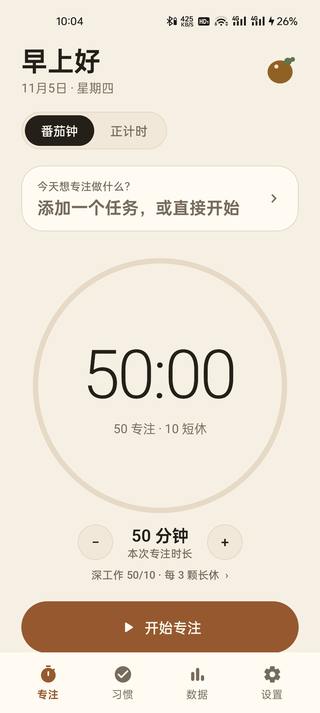
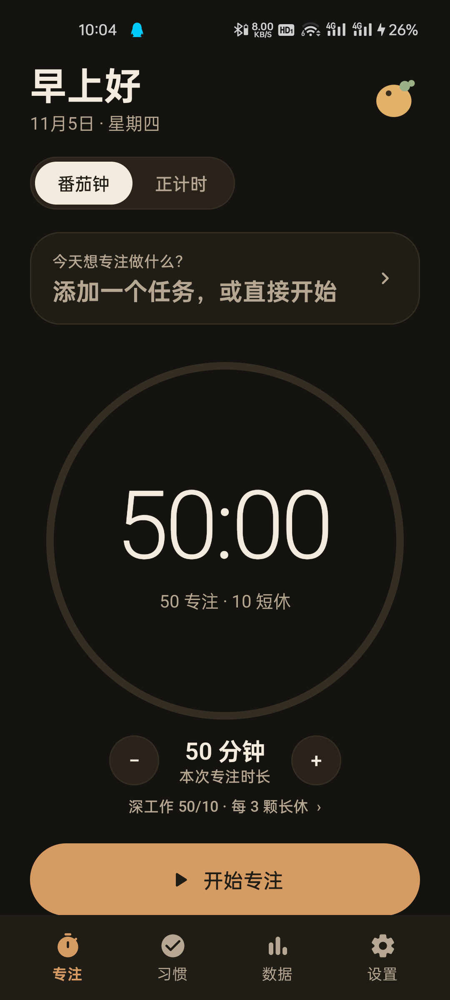

# Potato

**一个极简、安静、可自定义的 Android 专注计时与习惯养成应用。**

番茄钟 + 正计时 + 习惯打卡 + 时间记录，本地优先，无需账号。

[下载最新测试版 APK](https://github.com/apasserbyx/potato/releases/latest) ·
[习惯模块设计](docs/HABITS.md) ·
[改进计划](docs/IMPROVEMENT_PLAN.md) ·
[产品设计](docs/DESIGN.md)




---

## 功能

### 专注

- 番茄钟：专注 / 短休 / 长休，支持自动开始休息
- 正计时：不设终点，结束后自动写入专注记录
- 专注页内直接按 5 分钟增减本次专注时长
- 暂停、继续、提前结束，暂停时间不计入专注分钟
- 绝对时间戳计时，锁屏、后台、App 被系统杀掉后仍可恢复
- 前台服务 + AlarmManager 双重保障
- 结束提醒与锁屏常驻通知

### 习惯

- 计时型习惯：目标分钟数，开始后进入专注页倒计时，完成后自动打卡
- 次数型习惯：例如喝水 3 杯，支持 +1 / −1
- 每天 / 自选星期重复
- 早 / 中 / 晚汇总提醒
- 提醒时间可在设置中修改
- 每个习惯独立连续天数
- 手动补完成、今天跳过、编辑、移除
- 点击提醒通知直接打开习惯页

### 任务

- 快速添加、选择、完成、删除任务
- 任务标签与预估番茄数
- 任务完成后自动从待办列表隐藏

### 数据

- 今日专注分钟、番茄数、自由专注次数
- 最近 7 天 / 30 天趋势
- 标签时间分布
- 记录明细
- JSON 数据导出

### 体验

- 一次性完成的完整 Android 原生体验
- 土豆配色与手绘土豆图标
- 浅色 / 深色模式
- 本地优先，无需注册

---

## 技术栈

- Kotlin
- Jetpack Compose + Material 3
- SQLite（`SQLiteOpenHelper`，数据库版本迁移）
- 前台服务 + AlarmManager + BroadcastReceiver
- 普通通知 + 通知操作 + 深链
- Gradle + Android SDK 35

最低支持 Android 8.0（API 26），目标 SDK 35。

---

## 构建

需要：

- JDK 21
- Android SDK 35
- Android SDK Build Tools 35.x

在项目根目录创建 `local.properties`，指向本机 Android SDK：

```properties
sdk.dir=/path/to/Android/Sdk
```

Windows 示例：

```properties
sdk.dir=D\:\\android sdk
```

构建 Debug APK：

```bash
./gradlew :app:assembleDebug
```

APK 输出：

```text
app/build/outputs/apk/debug/app-debug.apk
```

运行单元测试：

```bash
./gradlew :app:testDebugUnitTest
```

---

## 项目结构

```text
app/src/main/java/com/potato/focus/
  data/        数据库、模型、DAO、统计与习惯计算
  timer/       计时状态机、前台服务、闹钟、通知
  habits/      习惯提醒排程、接收器与通知
  ui/
    focus/     专注页
    habits/    习惯页
    stats/     数据页
    settings/  设置页
    components/通用组件
    theme/     土豆配色与主题
  util/        时间格式化、数据导出
```

设计文档：

- [产品设计](docs/DESIGN.md)
- [习惯模块设计](docs/HABITS.md)
- [改进计划书](docs/IMPROVEMENT_PLAN.md)

---

## 权限说明

- `POST_NOTIFICATIONS`：计时结束和习惯提醒
- `FOREGROUND_SERVICE` / `FOREGROUND_SERVICE_SPECIAL_USE`：后台计时
- `SCHEDULE_EXACT_ALARM`：精确提醒
- `RECEIVE_BOOT_COMPLETED`：重启后恢复提醒排程
- `VIBRATE`：完成与提醒触感

所有提醒都遵循系统静音、免打扰和通知渠道设置，不绕过用户的系统选择。

---

## 隐私

- 默认完全本地存储，不需要账号，不上传专注记录
- 导出数据只会在用户主动分享时离开设备
- 当前版本没有云同步

---

## 当前限制

- Release APK 为测试版签名，适合个人安装与体验，不适合应用商店分发
- 暂无数据导入恢复（已有导出）
- 习惯详情页、30 天热力图、自定义提示音与自定义图标正在规划中
- 国产 ROM 的后台限制仍需要真机验证

---

## License

当前项目未添加开源许可证。
